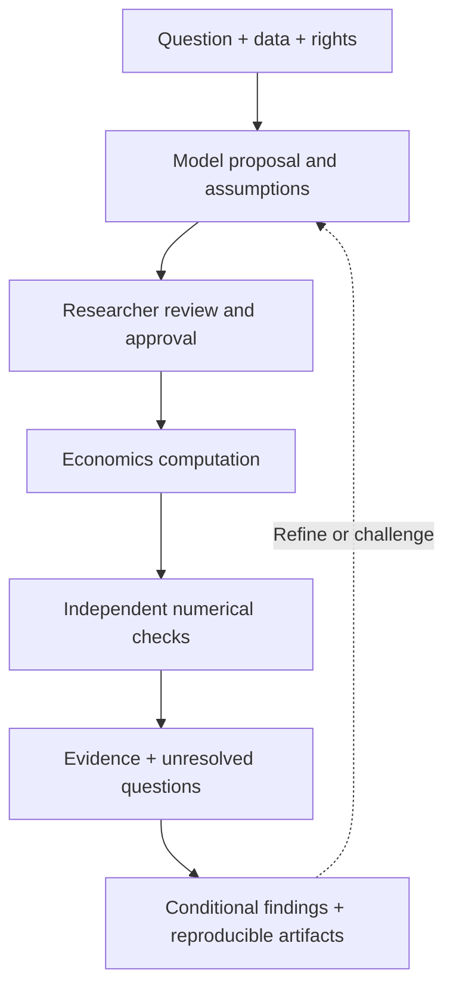

<div align="center">

# Society Box

### Economic research you can inspect, challenge, and reproduce.

**Local-first · Evidence-first · Researcher-controlled**


[](LICENSE)


*A research environment built to show not only what a model calculated, but what the evidence actually supports.*

**[What makes it different](#why-society-box) · [Current status](#what-works-today) · [Get started](#quick-start) · [Roadmap](#roadmap)**

</div>

---

## What is Society Box?

Society Box is an experimental, free and **local-first economics research environment**. It combines reproducible numerical computations with source-aware research workflows, explicit human approval, competing economic explanations, and transparent limits on what can be concluded.

Researchers choose their own questions, data, assumptions, and models. Computation produces inspectable outputs and verification records—**not automatically certified causal explanations or predictions**.

**The product boundary is deliberate:**

- **v1:** Build a complete economics research product, spanning economics methods, data handling, evidence, research UI, and reproducibility.
- **v1.1 onward:** Expand that economics foundation into the wider social sciences.

Both are *goals*, not claims of already completed coverage.

## Why Society Box?

| Principle | What it means |
|:--|:--|
| 🔎 **Competing explanations (IMFE)** | Explore plausible mechanisms behind observations, identify observational equivalence, and ask which additional evidence could distinguish them. |
| 🧾 **Evidence with open questions** | Track evidence, residual unknowns, verification obligations, and the scope of supported claims. |
| 🕰️ **Information at the right time** | Separate observation, release, revision, acquisition, training, and forecast dates. Declared timestamps are not publisher authentication. |
| 🔐 **Researcher approval** | Review model assumptions, data rights, and an exact input digest before approved execution. A changed model requires a fresh review. |
| 📐 **Real numerical methods** | Implement bounded, testable economics calculations with independent numerical checks and explicit failure conditions. |
| 💻 **Local-first and LLM-optional** | Run supported research workflows without an LLM. An LLM can help propose a model, but cannot substitute for evidence or execution approval. |

### Research flow



*Scientific interpretation is a separate step from numerical correctness.*

## What works today?

**Pre-alpha — version `0.1.0a2` in the source package. No stable v1 release yet.**

| Area | Current scope |
|:--|:--|
| Economics study workflow | **16 bounded registered study families**, including selected regression, forecasting, optimization, input-output, survey, and inverse-analysis paths. |
| Independent economics APIs | Working implementations in areas such as IV/GMM, dynamic panels, VAR, GLM, quantile regression, random effects, and linear-Gaussian state space. **Not all are connected to the research chat UI.** |
| Selected native solvers | Some fixed and verified execution paths for HiGHS, Pyomo, SimPy and NetworkX; other upstream dependencies may be unavailable. |
| Evidence and reproducibility | Digest-bound approvals, calculation records, unknowns, re-execution, and explicit numerical/assumption limitations for supported workflows. |
| Data vintages | Initial vintage-aware validation and a pinned WDI retrieval example. **Not a general authenticated historical point-in-time database.** |
| Chat research workspace | Local research chat entry point and `NO_LLM` workflow. Full model/provider integrations remain development work. |

**Not yet established:** full economics coverage, execution parity with all referenced open-source libraries, equivalence to commercial software, broad real-world empirical replication, independent clean-install acceptance, or production/enterprise readiness.

## Quick start

Start from a source checkout, with **Python 3.10+** available. Windows is the primary development environment.

```powershell
# Inspect the available CLI commands
python -B -m societybox --help

# Launch the local research-chat workspace
python -B -m societybox research-chat --workspace research_data/research-chat-local --ttl-seconds 3600
```

The CLI prints a local loopback address for the research interface. The default workflow does **not** require sending research data to an LLM. Some optional/native calculations require separately verified local runtimes and source dependencies.

### Reproducible economics example

```powershell
# Read the declared model, inputs, assumptions and digest
python -B -m econscope.engine_study review --study examples/engine_consumption_study.json

# After reviewing the exact output, supply its actual review digest:
python -B -m econscope.engine_study run --study examples/engine_consumption_study.json --acknowledge-review YOUR_REVIEW_SHA256 --output NEW_PRIVATE_BUNDLE

# Verify that output against the recorded computation
python -B -m econscope.engine_study verify --bundle NEW_PRIVATE_BUNDLE
```

The example uses **synthetic economic inputs**. It does not establish real policy effects, scientific causality, or empirical predictive skill.

### Run a small regression test set

```powershell
python -B -m unittest tests.test_numeric_linear tests.test_generalized_linear tests.test_state_space -q
```

Additional tests can require fixed external runtimes, locally acquired reference sources, or test data that are **not included** in a clean distribution. A passing unit test is not proof of scientific validity.

## Roadmap

| Phase | Direction |
|:--|:--|
| **v1 · Economics** | Expand core econometrics, structural micro/macro, finance, industrial organization, trade, labor, public economics, energy, environment, simulation, and optimization. Validate upstream API behavior, historical data vintages, provenance, and mathematical counterexamples. Complete the research-facing product and its deployment within v1. |
| **v1.1+ · Social sciences** | Extend the same evidence-first foundation with dedicated methods for sociology, political science, psychology, education, demography, history, and other social sciences. |

There is no artificial cap on the number of mathematics-based economics functions in the v1 goal; each implementation still has explicit resource, scientific, and legal boundaries.

## Repository map

| Path | Purpose |
|:--|:--|
| `econscope/` | Economics calculations, research engines, evidence and workflow logic |
| `societybox/` | Product CLI and entry points |
| `tests/` | Mathematical oracles, failure cases, and regression tests |
| `examples/` | Source-authored example studies |
| `pyproject.toml` | Package and command metadata |
| `LICENSE`, `NOTICE` | License and third-party rights boundaries |

**Publication boundary:** private planning documents, agent instructions, historical internal archives, local research workspaces, credentials, proprietary assets, third-party reference archives, and original research datasets are **not part of the intended public source distribution**. Published material must come from a reviewed, clean snapshot—not the historical development Git tree.

## License and scientific limits

Society Box's own source is offered under the **Apache License, Version 2.0** (see [LICENSE](LICENSE) and [NOTICE](NOTICE)). Apache-2.0 includes an express patent-license grant from contributors for applicable contributions and requires preserving relevant notices. The earlier source-only snapshot was issued under MIT; that prior permission is not revoked. This proposed relicensing should be merged only after confirming rights to license all included contributions. This does **not** automatically grant rights to third-party research software, archived source trees, datasets, documentation, or commercial products. Functional inspiration is implemented independently using legally accessible mathematics and documented methods.

A solver can be numerically correct while its identification assumptions, source authenticity, data availability, or policy interpretation remain unverified. Society Box makes those boundaries explicit.

---

<details>
<summary><strong>한국어 · 프로젝트 소개</strong></summary>

**Society Box는 경제학 연구를 위한 무료·로컬 우선·증거 중심 분석 환경을 목표로 개발 중인 프로젝트입니다.** 연구자가 질문·자료·모형·가정·실행을 통제하고, 계산 결과와 함께 검증된 부분 및 아직 확인하지 못한 사항을 표시합니다.

- **v1:** 경제학 전 분야의 계산 기능과 연구 제품 전체 완성
- **v1.1부터:** 경제학 기반을 사회과학 전 분야로 확대
- **현재:** pre-alpha. 계량·패널·시계열·최적화 등의 일부 실제 계산 코어와 연구 워크플로가 구현됐지만, 경제학 전체 완성 또는 상용 프로그램과의 완전한 동등성을 뜻하지는 않습니다.
- **특징:** IMFE 경쟁 메커니즘 탐색, Evidence/Unknown/Verification Obligation, 데이터 빈티지, 연구자 승인, 독립 수치 검증, 선택적 LLM 사용

개인 연구자료·비공개 디자인·내부 개발 문서는 배포 대상에서 제외합니다.

</details>

<div align="center">

**Society Box · Compute carefully. Question the evidence. Keep the unknowns visible.**

</div>
